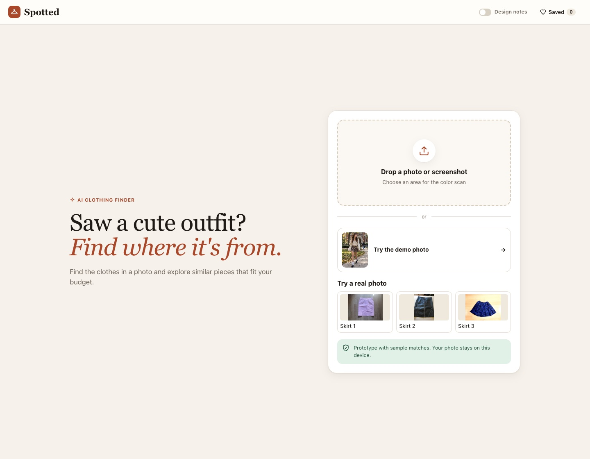
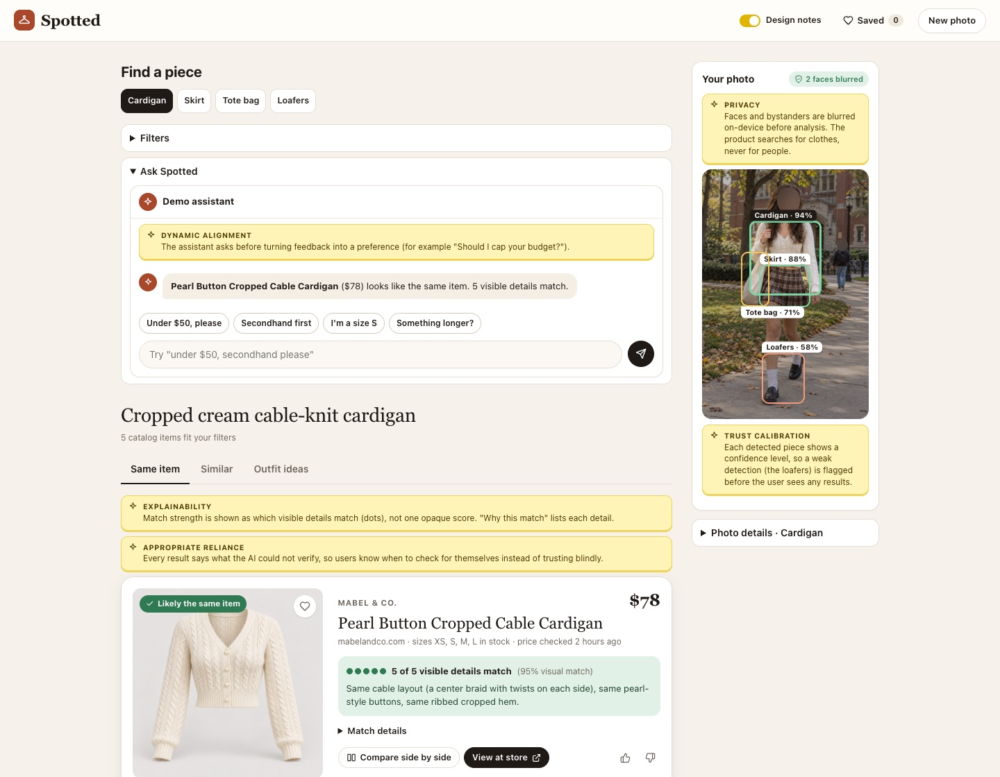

# Spotted

**A clothing search prototype for outfits you see in real life.** Upload a photo, select a garment, and search a reference collection of 5,756 real clothing photos for visually similar pieces. Reference results show simulated prices and conditions.

**[Try the hosted demo](https://evelynw11.github.io/spotted/)** · [Download the standalone HTML](spotted-demo.html)

| Mode | What you can try | Where to run it |
|---|---|---|
| Scripted walkthrough | Explore simulated detections, catalog matches, and shopping preferences with **Try the demo photo**. | Hosted or standalone demo |
| Local color scan | Upload a photo or choose **Try a real photo**, then search the sample catalog by color. | Hosted or standalone demo |
| Reference dataset search | Use Bedrock to analyze an uploaded garment and compare it with the full reference collection on your Mac. | [Local server with AWS](#search-the-reference-dataset-with-amazon-bedrock) |


*Screenshot from the scripted walkthrough.*

---

## The problem

You see a cute outfit on the way to class. You want it, but asking a stranger where it's from feels awkward. So you screenshot it and spend half an hour on Pinterest or reverse image search, and usually come up empty.

Reverse image search can find visually similar items, but it can't take into account what *you* care about, such as a budget, buying secondhand, or avoiding fast fashion. It also doesn't tell you how confident it is or why a result matched.

## Who it's for

People (especially students) who want to buy clothing they've seen in person or online, but don't know what it is or where to find it.

## Prototype scope

The reference search compares one selected garment crop with the local image dataset. The scripted walkthrough demonstrates shopping preferences using fictional listings. Its filters control which listings qualify, and preferences such as preferred brands and sustainability affect their order. Live shopping links and inventory are future work.

## Scan your photo by color

1. Upload or drop a garment photo, or choose one under **Try a real photo**. Drag the scan box over the garment and resize it from the lower-right corner.
2. Check the scanned color, choose a garment category, and set any shopping preferences.
3. Select **Confirm and search** to rank sample listings by color and preferences.

The scan samples pixels inside the selected box and compares the median color with catalog swatches. Lighting and anything else inside the box can affect the result. The selected category limits which sample listings appear.

## Search the reference dataset with Amazon Bedrock

This mode uses all 5,756 photos available in the publisher’s [CC0 Clothing Dataset archive](https://github.com/alexeygrigorev/clothing-dataset), the lower-resolution edition of the Kaggle dataset. Use macOS 14 or later with Apple Command Line Tools, Python 3.9 or later, Node.js 16.9 or later, and AWS CLI v2. Configure an AWS CLI profile with `bedrock:InvokeModel` access.

```bash
python3 scripts/prepare-dataset.py
BEDROCK_VISION=1 AWS_PROFILE=your-profile AWS_REGION=us-east-1 node server.js
```

The first command downloads the photos, creates the catalog in the ignored `reference-data/` directory, and builds a local Apple Vision feature index. It can also use an existing publisher ZIP with `--zip /path/to/dataset.zip`. The setup sends no photos to AWS. Each reference uses its dataset category and audience label when available, with a stable simulated USD price and condition. Photos without labels are still indexed. The publisher archive has five metadata rows whose image files are missing.

1. Open [Spotted on your Mac](http://127.0.0.1:4173) and upload a garment photo.
2. Move and resize the scan box to cover the garment. Select **Analyze garment** to send the selected crop to Amazon Bedrock. Bedrock identifies the garment category and visible details.
3. Spotted uses the detected category to narrow the search, then compares the crop with the local Apple Vision index. It displays up to 12 reference photos that pass the similarity cutoff. If none pass, it displays **No close matches found**.

The default similarity cutoff is `0.68`. Lower `REFERENCE_MAX_DISTANCE` values require a closer visual match. `BEDROCK_MODEL_ID` overrides the default Amazon Nova Lite US inference profile. The server offers the sample catalog workflow when Bedrock is enabled and the dataset index is unavailable.

### AWS usage and stopping the server

**Analyze garment** is the only action that sends a crop to AWS and can incur a Bedrock charge. Dataset preparation, image matching, and the color preview run locally. Press **Ctrl+C** in the terminal running `node server.js` to stop Spotted and prevent new scans from that server.

## Try the scripted walkthrough

1. Open the hosted or standalone demo and select **Try the demo photo**. The animation illustrates face blurring and detection of four sample pieces.
2. Keep **Cardigan** selected, leave the shopping preferences blank, and select **Confirm and search**.
3. In **Same item**, open **Compare side by side** to see the photo and sample listing, with five matching visible details.
4. Open **Ask Spotted**. Select **Under $50, please**, then **Secondhand first**. Open **Similar** to see the filtered and re-ranked listings.
5. On the TrendMart cardigan, choose **Not for me** and select **Not sustainable enough**. The demo assistant asks before applying a broader fast-fashion preference.
6. Open **Filters** and select **Reset** to clear the budget. Return to **Same item**. In **Photo details**, change the cardigan color to *Oatmeal / beige* to see how a correction affects the exact-match result. Use **Undo** in **Filters** to reverse the color correction.
7. Select **Loafers** to see the example with no confirmed exact match. Return to **Cardigan** and open **Outfit ideas** for styling suggestions and sample totals.
8. Turn on **Design notes** to see how the walkthrough illustrates the course concepts.

## Screenshots

These screenshots show the standalone demo, including the scripted walkthrough.

| | |
|---|---|
|  **Home** |  **Scripted analysis** |
|  **Side-by-side comparison** |  **Budget and secondhand preferences** |
|  **Feedback confirmation** |  **No confirmed exact match** |
|  **Outfit ideas** |  **Design notes** |

## Human-AI interaction concepts

| Concept | How the prototype illustrates it |
|---|---|
| **Trust calibration and appropriate reliance** | Each detected piece and detail shows a confidence level ("Sure / Fairly sure / Not sure"). Result cards and comparison views flag details to verify before buying. For low-confidence items, it refuses to guess an exact match. |
| **Explainability** | Match strength is shown as which visible details match (dots), not one opaque score. Similar cards have a "Why this match?" breakdown, the compare view shows details side by side, and the re-rank banner includes an "Explain" link. |
| **Dynamic alignment** | Preferences are labeled *you set* or *inferred*. Inferred ones need a Keep or Remove. The assistant asks before turning feedback into a rule, explains tradeoffs (e.g. the exact item is over budget), and every change can be undone. |
| **Error recovery** | You can correct what the AI *saw* ("the color is actually beige") separately from what you *want* ("show me other colors"), and lock must-have details. |
| **Privacy** | The color scan runs in the browser. **Analyze garment** sends the selected crop to Bedrock. The scripted walkthrough illustrates face blurring. |

## How the sample catalog works

- **Matching:** Each detected piece has a set of attributes (color, knit, neckline, buttons, length...). Each listing is scored detail by detail (same / close / different), weighted, and labeled *Likely the same item*, *Very close*, *Similar* or *Same vibe*.
- **Filtering and ranking:** Price bounds, brand exclusions, secondhand eligibility, and explicit fast-fashion exclusions filter the curated catalog before scoring. Visual similarity, preferred brands, sustainability, and other ranking preferences order the eligible results. “Show anyway” can reveal feedback-hidden listings that still meet the catalog filters.
- **Assistant:** A small keyword parser turns chat messages into preference updates, and scripted responses explain the effect of each change.

## Run the standalone demo

Open the HTML file directly in your browser. The standalone demo requires no setup.

```bash
git clone https://github.com/evelynw11/spotted.git
cd spotted
open spotted-demo.html
```

If you edit the code, rebuild the single-file version with Node:

```bash
node build.js            # writes spotted-demo.html with CSS, JS and images inlined
```

## Project structure

```
index.html          App shell
styles.css          All styles
app.js              Demo data, photo scanning, matching and ranking, views, events
server.js           Local web server and Amazon Bedrock garment analysis endpoint
img/                Demo images and three dataset samples
scripts/prepare-dataset.py      Downloads photos and assigns sample catalog metadata
scripts/reference-search.m      Builds and searches the local Apple Vision index
reference-data/                Downloaded photos, catalog, and index (generated locally)
build.js            Bundles everything into spotted-demo.html
spotted-demo.html   Self-contained single-file demo
docs/screenshots/   Screenshots used in this README
```

## Roadmap

The places to swap in real models are marked with `// LIVE:` in `app.js`.

| Prototype piece | Real version |
|---|---|
| `ITEMS` (detected pieces, boxes, attributes, confidence) | A vision model returning JSON with boxes, attributes and a confidence per attribute |
| `PRODUCTS` (curated demo catalog) | Expand the preference-filterable collection. Live product search is a reach goal. |
| `OUTFITS` and assistant replies | A language model given the attributes and the user's preferences |
| `handleUserText` keyword parser | An LLM call that returns structured preference updates |
| Uploaded photo (local color scan or Bedrock analysis of a selected crop) | Detect multiple garment regions automatically |

## Course context

Built as a project prototype for **05-318 Human-AI Interaction** at Carnegie Mellon University (Fall 2026).

## Disclaimer

All brands, stores, prices and listings in this demo are fictional. The scripted walkthrough and fictional catalog use AI-generated images. **Try a real photo** uses three real skirt images from Alexey Grigorev’s [CC0 Clothing Dataset](https://github.com/alexeygrigorev/clothing-dataset), the lower-resolution source for the [Kaggle dataset](https://www.kaggle.com/datasets/agrigorev/clothing-dataset-full). The sample image IDs in display order are `70045b01-b350-4918-be74-2f627290ad7a`, `d44cfac9-3fda-47ba-8eb1-8b130f60b08c`, and `f8b84112-9110-4628-91e8-9d22a13767f3`.
