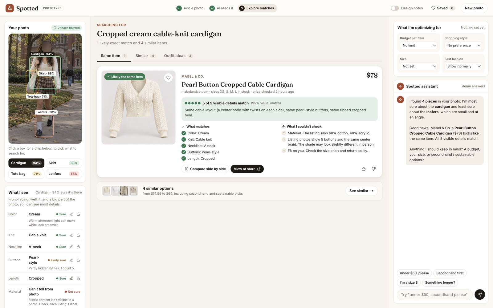
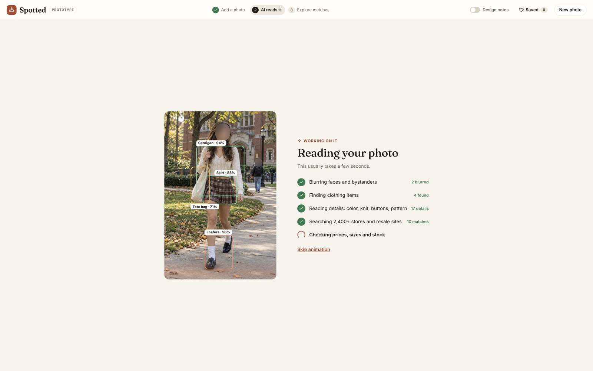
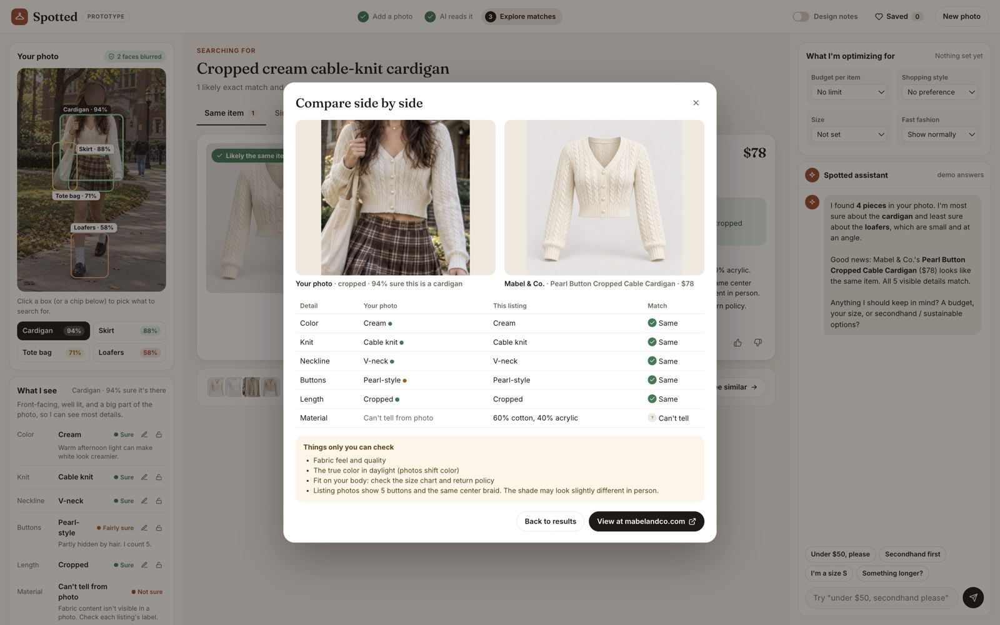
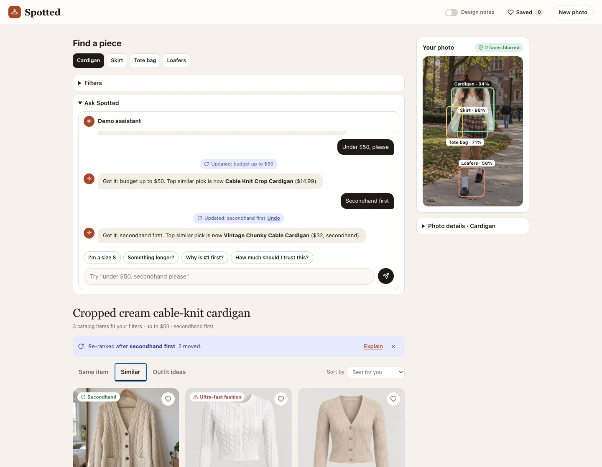
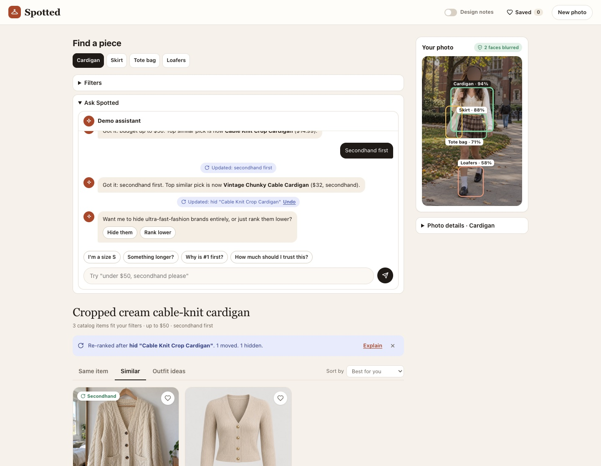
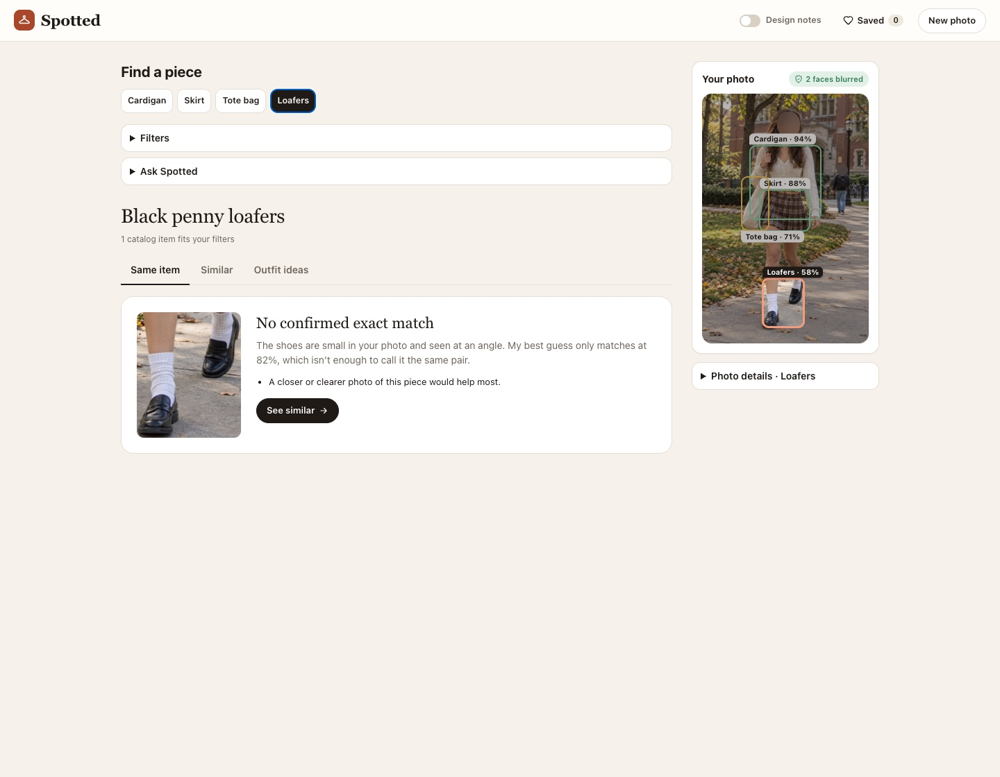
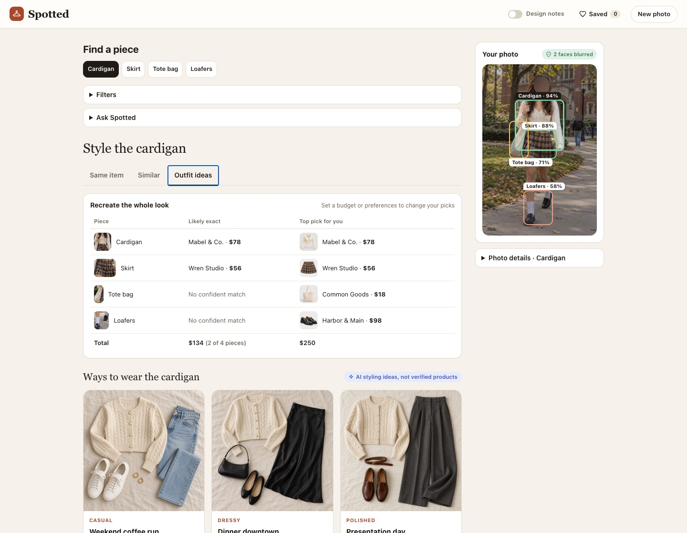

# Spotted

**An AI clothing finder for outfits you see in real life.** Upload a photo of an outfit you liked, and Spotted finds where to buy the exact piece, or close alternatives that fit your budget and values. Every result shows *why* it was picked and *what you should double-check* before buying.

**[Try the live demo](https://evelynw11.github.io/spotted/)** · [Download the single-file version](spotted-demo.html) (open it in Chrome, no install needed)

> **This is a prototype with a working photo color scan.** Upload your own photo or try the scripted outfit walkthrough. Catalog listings are fictional. Color scanning runs in your browser. Optional garment analysis sends the selected crop to Amazon Bedrock.



---

## The problem

You see a cute outfit on the way to class. You want it, but asking a stranger where it's from feels awkward. So you screenshot it and spend half an hour on Pinterest or reverse image search, and usually come up empty.

Reverse image search can find visually similar items, but it can't take into account what *you* care about, such as a budget, buying secondhand, or avoiding fast fashion. It also doesn't tell you how confident it is or why a result matched.

## Who it's for

People (especially students) who want to buy clothing they've seen in person or online, but don't know what it is or where to find it.

## Minimum goal

Users confirm a detected piece and set optional shopping preferences before searching a curated catalog. Price bounds, excluded brands, and secondhand eligibility define which listings can appear. Preferred brands and priorities such as sustainability influence ranking alongside visual similarity. Users can refine these choices after seeing their matches. Live web search is a reach goal.

## Scan your own photo

1. Upload or drop a garment photo, or choose one under **Try a real photo**. Drag the scan box over the garment and resize it from the lower-right corner.
2. Check the scanned color, choose a garment category, and set any shopping preferences.
3. Select **Confirm and search** to rank sample listings by color and preferences.

The scan samples pixels inside the selected box and compares the median color with catalog swatches. Lighting and anything else inside the box can affect the result. The upload flow uses your garment category and shows color-based results.

## Search the reference dataset with Amazon Bedrock

This mode uses the complete [CC0 Clothing Dataset](https://github.com/alexeygrigorev/clothing-dataset) from the publisher’s GitHub repository, the smaller image resolution version of the Kaggle dataset. Install Python 3.9+, Node.js 16.9+, AWS CLI v2, and the macOS 14+ command-line developer tools. Configure an AWS CLI profile with `bedrock:InvokeModel` access.

```bash
python3 scripts/prepare-dataset.py
BEDROCK_VISION=1 AWS_PROFILE=your-profile AWS_REGION=us-east-1 node server.js
```

The first command downloads the photos, creates the catalog in the ignored `reference-data/` directory, and builds a local Apple Vision feature index. It can also use an existing publisher ZIP with `--zip /path/to/dataset.zip`. The setup sends no photos to AWS. Every reference includes the dataset category, audience label, and a stable simulated USD price and condition.

Open [http://127.0.0.1:4173](http://127.0.0.1:4173), upload a photo, fit the box around the garment, and select **Analyze garment**. Bedrock analyzes that crop for category and visible details. Spotted compares the crop with the locally indexed photos and shows up to 12 closest references that pass the cutoff. If none pass, it shows **No close matches found**. Reference cards contain simulated shopping data and have no purchase links.

`REFERENCE_MAX_DISTANCE` adjusts the Apple Vision distance cutoff (default 0.68). Lower values require a closer image match. `BEDROCK_MODEL_ID` overrides the default Amazon Nova Lite US inference profile. Only **Analyze garment** sends the selected crop to AWS. The standalone HTML and GitHub Pages demo use local color scanning. If you start the server with Bedrock enabled before preparing the dataset, it offers the original sample catalog workflow.

## What the scripted walkthrough does

1. **Reads your photo.** Detects each clothing piece (cardigan, skirt, bag, shoes), with a confidence level for each. Faces and bystanders are blurred first.
2. **Finds the same item when it can.** Shows a "likely the same item" match, which visible details match, and what it couldn't check (fabric, true color, fit).
3. **Finds close alternatives when it can't.** Similar items from new, secondhand and sustainable sellers, each with a "Why this match?" breakdown and a "Before you buy" note.
4. **Adapts to you.** Tell the assistant "under $50" or "secondhand please" (or use the preference panel). Results re-rank, and a banner shows what moved and why. Every change can be undone.
5. **Learns from feedback, but asks first.** A thumbs-down asks what's off. Instead of silently changing your preferences, the assistant asks, e.g. "Should I cap your budget at $50?". Anything it infers is labeled *inferred* until you keep or remove it.
6. **Admits when it doesn't know.** For small or generic items (the loafers, a plain tote), it won't guess an exact match. It explains why and suggests what to do instead.
7. **Suggests outfits.** AI styling ideas built around the found piece, plus what it would cost to recreate the whole look with your preferences.

## Try it: 2-minute walkthrough

1. Open the [live demo](https://evelynw11.github.io/spotted/) and click **Try the demo photo**.
2. Watch it detect four pieces. Confirm the cardigan, optionally set a price range or exclude a catalog brand such as TrendMart, then click **Confirm and search**. Leave preferences blank to reproduce the rest of this walkthrough.
3. **Same item** tab: the likely exact cardigan, with 5 of 5 visible details matching. Click **Compare side by side**.
4. Open **Ask Spotted** and click **Under $50, please**, then **Secondhand first**. Notice the re-rank banner and how the assistant explains the tradeoffs.
5. Try **Filters** to adjust the price range or exclude brands. In **Similar**, thumbs-down the TrendMart cardigan and choose **Not sustainable enough**. The assistant asks before hiding fast fashion.
6. Open **Photo details** and fix the color to *Oatmeal / beige*. The exact match drops out, and the assistant explains why. Open **Filters** and click **Undo**.
7. Click **Loafers**: low confidence, so it refuses to guess and tells you what would help.
8. **Outfit ideas** tab: three ways to wear the cardigan, plus the cost of the whole look.
9. Turn on **Design notes** (top right) to see which HCI concept each feature demonstrates.

## Screenshots

| | |
|---|---|
|  **Home:** upload a photo or try the demo |  **Analyzing:** blur faces, detect pieces with confidence |
|  **Compare:** your photo vs. the listing, detail by detail |  **Re-rank:** results adapt to "under $50, secondhand" |
|  **Feedback:** the assistant asks before learning a rule |  **Honest uncertainty:** no guessing on low-confidence items |
|  **Outfit ideas:** styling suggestions and whole-look cost |  **Design notes:** presenter mode mapping features to concepts |

## Human-AI interaction concepts

| Concept | How Spotted applies it |
|---|---|
| **Trust calibration and appropriate reliance** | Each detected piece and detail shows a confidence level ("Sure / Fairly sure / Not sure"). Each result has "Before you buy" and "What I couldn't check" notes. For low-confidence items, it refuses to guess an exact match. |
| **Explainability** | Match strength is shown as which visible details match (dots), not one opaque score. Every result has a "Why this match?" breakdown, a side-by-side compare table, and an "Explain" link after each re-rank. |
| **Dynamic alignment** | Preferences are labeled *you set* or *inferred*. Inferred ones need a Keep or Remove. The assistant asks before turning feedback into a rule, explains tradeoffs (e.g. the exact item is over budget), and every change can be undone. |
| **Error recovery** | You can correct what the AI *saw* ("the color is actually beige") separately from what you *want* ("show me other colors"), and lock must-have details. |
| **Privacy** | Uploads are processed locally in the browser. The scripted walkthrough illustrates face blurring. |

## How the prototype works

- **Matching:** Each detected piece has a set of attributes (color, knit, neckline, buttons, length...). Each listing is scored detail by detail (same / close / different), weighted, and labeled *Likely the same item*, *Very close*, *Similar* or *Same vibe*.
- **Filtering and ranking:** Price bounds, brand exclusions, secondhand eligibility, and explicit fast-fashion exclusions filter the curated catalog before scoring. Visual similarity, preferred brands, sustainability, and other ranking preferences order the eligible results. “Show anyway” can reveal feedback-hidden listings that still meet the catalog filters.
- **Assistant:** A small keyword parser turns chat messages into preference updates, and scripted responses explain the effect of each change.

## Run it locally

No build step or dependencies needed.

```bash
git clone https://github.com/evelynw11/spotted.git
cd spotted
open index.html          # or double-click spotted-demo.html
```

If you edit the code, rebuild the single-file version with Node:

```bash
node build.js            # writes spotted-demo.html with CSS, JS and images inlined
```

## Project structure

```
index.html          App shell
styles.css          All styles
app.js              Demo data, photo scanning, matching and ranking, views, events
server.js           Local web server and Amazon Bedrock garment analysis endpoint
img/                AI-generated demo photos (street photo, products, outfit flat lays)
build.js            Bundles everything into spotted-demo.html
spotted-demo.html   Self-contained single-file demo
docs/screenshots/   Screenshots used in this README
```

## Roadmap: making it real

The places to swap in real models are marked with `// LIVE:` in `app.js`.

| Prototype piece | Real version |
|---|---|
| `ITEMS` (detected pieces, boxes, attributes, confidence) | A vision model returning JSON with boxes, attributes and a confidence per attribute |
| `PRODUCTS` (curated demo catalog) | Expand the preference-filterable collection. Live product search is a reach goal. |
| `OUTFITS` and assistant replies | A language model given the attributes and the user's preferences |
| `handleUserText` keyword parser | An LLM call that returns structured preference updates |
| Uploaded photo (local color scan or Bedrock analysis of a selected crop) | Detect multiple garment regions automatically |

## Course context

Built as a project prototype for **05-318 Human-AI Interaction** at Carnegie Mellon University (Fall 2026).

## Disclaimer

All brands, stores, prices and listings in this demo are fictional. The scripted walkthrough and fictional catalog use AI-generated images. **Try a real photo** uses three real skirt images from Alexey Grigorev’s [CC0 Clothing Dataset](https://github.com/alexeygrigorev/clothing-dataset), the lower-resolution source for the [Kaggle dataset](https://www.kaggle.com/datasets/agrigorev/clothing-dataset-full). The sample image IDs in display order are `70045b01-b350-4918-be74-2f627290ad7a`, `d44cfac9-3fda-47ba-8eb1-8b130f60b08c`, and `f8b84112-9110-4628-91e8-9d22a13767f3`.
